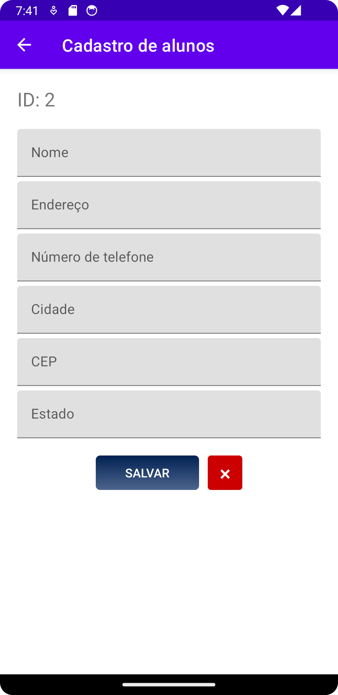
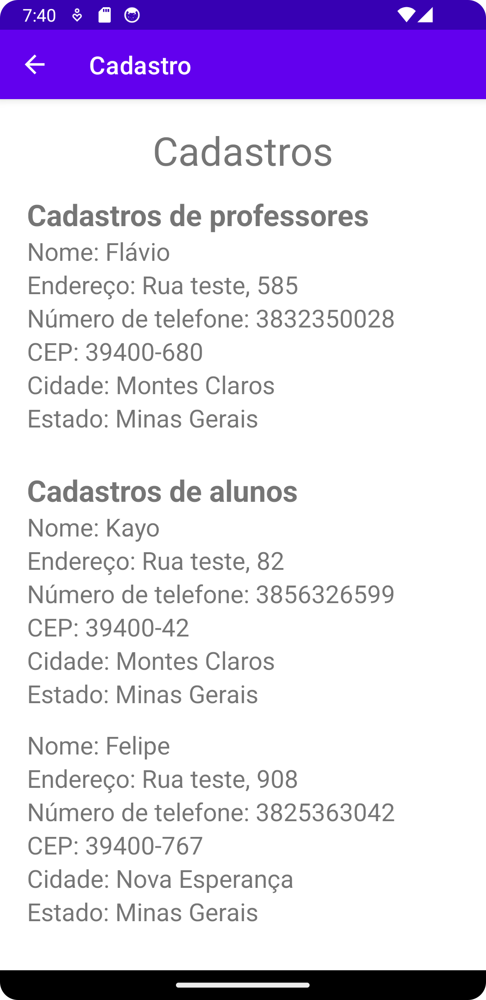

[English](README.md) | **Português (Brasil)**

<h1 align="center">Cadastro de alunos e professores</h1>

### Descrição

Aplicativo Android escrito em Java para cadastrar alunos e professores e listar as pessoas cadastradas. Foi desenvolvido como requisito parcial da disciplina de *Projeto Integrador I* do curso Técnico em Informática para Internet do Instituto Federal do Norte de Minas Gerais (IFNMG).

A interface do aplicativo está em português do Brasil. Os registros são armazenados no dispositivo por meio da API [SharedPreferences](https://developer.android.com/training/data-storage/shared-preferences) do Android (armazenamento privado do aplicativo), portanto permanecem salvos depois que o aplicativo é fechado. Não há servidor nem acesso à rede.

### Funcionalidades

- Cadastrar um aluno ou um professor com nome, endereço, telefone, CEP, cidade e estado.
- Cada registro recebe um ID numérico sequencial por tipo (alunos e professores são numerados separadamente).
- Limpar os campos do formulário com um toque.
- Ver todos os professores e alunos cadastrados em uma única tela.

### Capturas de tela

<center>



</center>

<center>



</center>

### Tecnologias

- Java (compatibilidade de origem/destino 1.8), Android SDK: `compileSdk` 34, `minSdk` 30, `targetSdk` 31
- Android Gradle Plugin 8.2.2, Gradle 8.2
- AndroidX AppCompat 1.6.1, Material Components 1.11.0, ConstraintLayout 2.1.4
- Armazenamento: `SharedPreferences`
- Testes (apenas os modelos padrão do Android Studio): JUnit 4.13.2, AndroidX Test / Espresso

### Requisitos

- [Android Studio](https://developer.android.com/studio) com o Android SDK Platform 34 instalado
- JDK 17 ou mais recente (exigido pelo Android Gradle Plugin 8.2)
- Um emulador ou dispositivo físico com Android 11 (API 30) ou superior

### Como executar

1. Clone o repositório e abra a pasta do projeto no Android Studio.
2. Aguarde a conclusão da sincronização do Gradle.
3. Selecione um emulador ou dispositivo conectado e execute a configuração `app`.

### Estrutura do projeto

```
app/src/main/java/com/kayo/cadastro/
  MainActivity.java   Tela inicial: cadastrar aluno, cadastrar professor, ver cadastros
  Cadastro.java       Formulário de cadastro (aluno ou professor, escolhido por extras da intent)
  Registers.java      Lista todos os cadastros armazenados
app/src/main/res/     Layouts, strings e temas
.github/              Capturas de tela usadas neste README
```

### Testes

O repositório contém apenas os testes de exemplo gerados pelo Android Studio (`ExampleUnitTest` e `ExampleInstrumentedTest`). Não há testes para o comportamento do aplicativo.

### Licença

[ISC](LICENSE.md) © 2024 Kayo Souza
